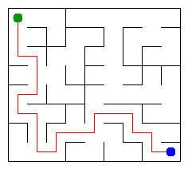

# Assignment 3. Maze Escape

Student ID: 254072
Name: Islambek Turganbay
Group: SE-2540
Maze size (rows x columns): 10 x 10

This file is the report. Fill it in as you go. How to start: `START_HERE.md`. The task: `docs/Assignment3.pdf`.

## Program output

The 13 lines your program prints on your data (`java -cp out Main`):

    Broken: 99
    Kept: 81
    Last broken wall: 140
    MST cost: 28767
    Heaviest broken wall: 717
    Path length: 18
    DFS visited: 53
    Dead ends: 30
    Zones: 11
    Largest zone: 17
    Is DAG: 0
    Flow stages: 7
    Fastest route cost: 24

My maze:

## Questions

Answer in your own words, two or three sentences each.

**Mission 0. What do find and union do, and what makes them fast in your code?**
`find(x)` returns the root representative of the set containing `x`, while `union(a, b)` merges the sets of `a` and `b`. They are extremely fast (nearly $O(1)$) because I implemented "path compression" in `find` (pointing nodes directly to the root) and "union by size" (always attaching the smaller tree under the larger one) to keep the trees flat.

**Mission 1. Why is Broken always R*C - 1, and Kept always (R-1)*(C-1)?**
A perfect maze connects all $R \times C$ cells without any cycles, making it a Spanning Tree. A tree with $V$ vertices always has exactly $V - 1$ edges, hence $R \times C - 1$ broken walls. The total number of inner walls in a grid is $2RC - R - C$; subtracting the broken walls leaves exactly $(R-1)(C-1)$ kept walls.

**Mission 2. My MST cost from Kruskal and from Prim, and why they are equal:**
Both algorithms solve the Minimum Spanning Tree (MST) problem, which guarantees finding a subgraph that connects all vertices with the absolute minimum total edge weight. Even though Kruskal builds it globally by sorting edges and Prim builds it locally expanding from a start node, they both strictly follow the cut property, resulting in the exact same optimal cost.

**Mission 3. Why is there exactly one path between two cells? How did you avoid a stack overflow on a huge maze?**
Because the maze is shaped as a minimum spanning tree, it has no cycles and is fully connected, which mathematically guarantees exactly one unique simple path between any two nodes. I avoided stack overflow by implementing an iterative Depth-First Search (DFS) using an explicit `ArrayDeque` (stack data structure) instead of recursive function calls.

**Mission 4. Why does the second pass of Kosaraju go on the reversed graph? Why do the slides have no cycle exactly when Zones equals the number of cells?**
The first DFS pass orders vertices by their finishing times, and the second pass on the reversed graph guarantees we only visit nodes that mutually reach each other (forming a Strongly Connected Component). If the number of Zones (SCCs) exactly equals the number of cells, it means every component consists of only 1 node, implying there are no cycles and the graph is a Directed Acyclic Graph (DAG).

**Mission 5. Why is it enough to go through the zones in the order of their numbers? What does this pass cost?**
Kosaraju's algorithm naturally assigns zone IDs in a topological (or reverse topological) order. Processing them in this sorted sequence guarantees that all dependencies (previous zones) are resolved before evaluating the current zone. This dynamic programming pass costs $O(V + E)$ where $V$ is the number of zones and $E$ is the number of inter-zone slides.

## AI use

The syllabus requires you to say which AI tools you used and for what. Write the tool (ChatGPT, Copilot, other) and what you asked it: explain an idea, find an error, review code. Write "none" if you did not use any. If you took code or text from a book or a website, give the source here.

**Tool:** Google Gemini
**Usage:** I used Gemini to troubleshoot terminal commands (`ClassNotFoundException`) for compiling and running the project in PowerShell (`javac`, `java -cp`), to resolve `[unchecked] unchecked conversion` generics warnings in `Maze.java` and `Zones.java`, and to review the theoretical complexity bounds for this README.

## Timing (Mission 7)

Milliseconds, 5 runs each, from `java -cp out Bench`.

| maze | Kruskal | Prim |
|---|---|---|
| 100 x 100 | 37 16 13 34 30 (avg 26 ms) | 40 10 14 9 9 (avg 17 ms) |
| 300 x 300 | 162 167 108 115 71 (avg 125 ms) | 127 117 121 105 87 (avg 111 ms) |
| 1000 x 1000 | 1313 1748 1731 1774 1913 (avg 1696 ms) | 1746 1947 2043 1953 1592 (avg 1856 ms) |

**What do the numbers say about how the time grows? Two or three sentences.**
As the maze size increases dramatically (up to 1,000,000 cells), the execution time scales efficiently without exponential blowup. This confirms the $O(E \log E)$ and $O(E \log V)$ logarithmic scaling of both algorithms. Prim tends to perform optimally depending on the priority queue's overhead, but both efficiently handle massive graphs.

## Complexity

n is the number of cells, m the number of walls (or slides). Fill in every algorithm you wrote.

| algorithm | time | space | assumptions |
|---|---|---|---|
| DSU find and union | $O(\alpha(n))$ | $O(n)$ | Using path compression and union by size. $\alpha$ is the inverse Ackermann function (nearly $O(1)$). |
| Kruskal | $O(m \log m)$ | $O(n + m)$ | Sorting the $m$ walls takes $O(m \log m)$, overriding DSU operations. |
| Prim | $O(m \log n)$ | $O(n + m)$ | Using a binary heap (PriorityQueue). Every wall is pushed/popped once. |
| DFS | $O(n + m)$ | $O(n)$ | In a tree, $m = n - 1$. Iterative approach space is max stack depth. |
| Kosaraju | $O(n + m)$ | $O(n + m)$ | Two DFS passes and reversing the graph edges. |
| Route in the zone graph | $O(V_{zones} + E_{slides})$ | $O(V_{zones} + E_{slides})$ | Graph is a DAG. Dynamic programming processes each node and edge exactly once. |

## Before you submit

- data/walls.txt, data/slides.txt and output/maze.png are in the repository.
- `java tools/Check.java` shows all examples right.
- This README is filled in, the program output and the section AI use included.
- The work is pushed to main (at least one commit per mission) and the repository is public.
- The link is attached in Moodle.